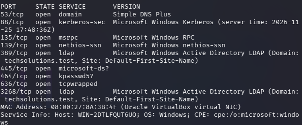
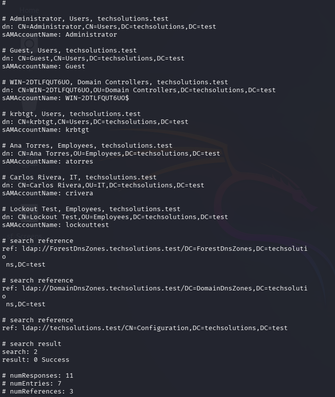
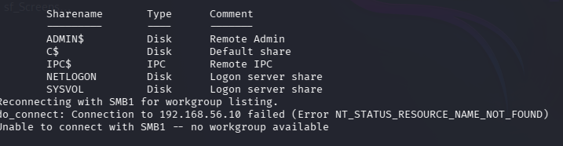
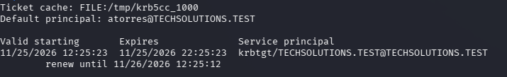
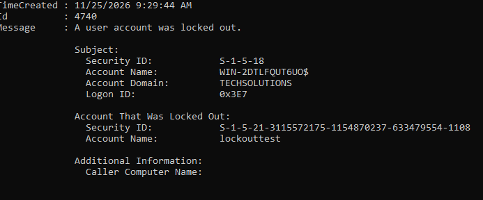
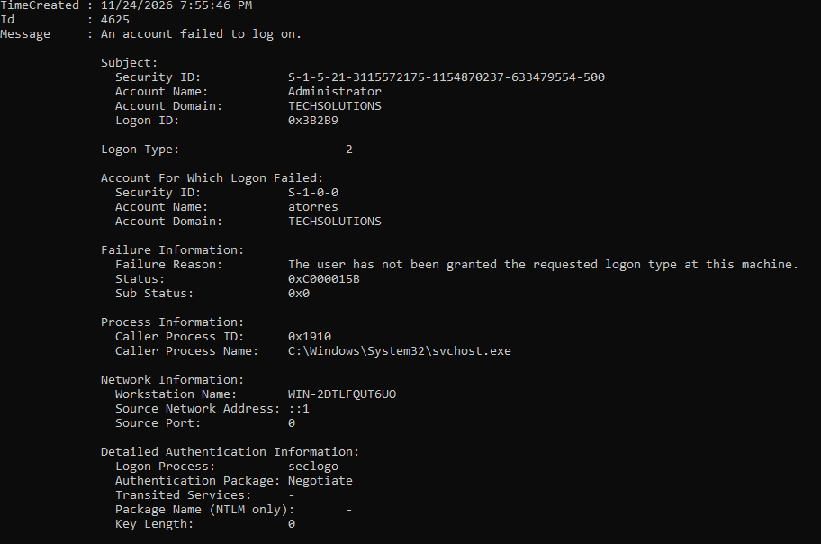
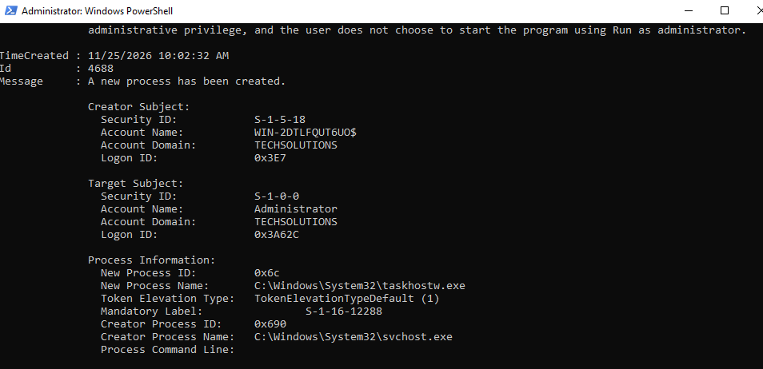
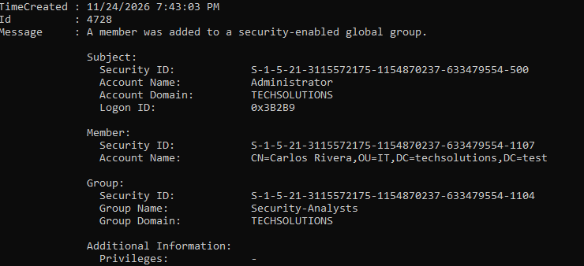
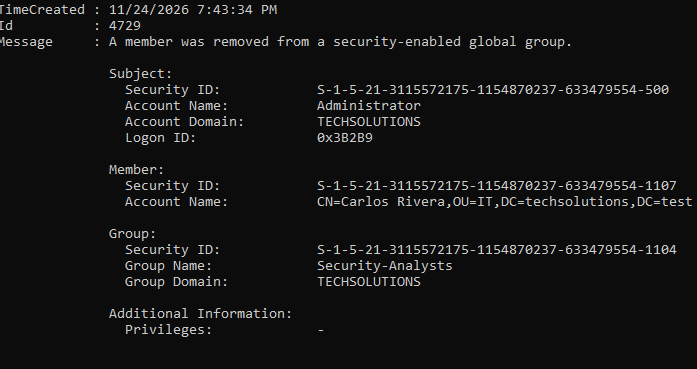

# Active Directory Security Lab
### Hands-on Cybersecurity | SOC Analysis | Junior Penetration Testing


## Project Overview

This project consists of building and analyzing an isolated Active Directory environment to practice Windows domain administration, network reconnaissance, authenticated enumeration, security auditing, and authentication monitoring.

The objective was to understand how an Active Directory environment can be assessed from both a system administration and cybersecurity perspective.

## Lab Architecture

| Component | Configuration |
|---|---|
| Domain Controller | Windows Server 2022 |
| Domain | `techsolutions.test` |
| NetBIOS | `TECHSOLUTIONS` |
| Domain Controller IP | `192.168.56.10` |
| Attacker Machine | Kali Linux |
| Kali Host-only IP | `192.168.56.30` |
| Kali NAT IP | `10.0.3.15` |
| Virtualization | Oracle VirtualBox |

### Network Design

- Host-only networking provided isolated communication between Kali and Windows Server.
- NAT networking provided Internet access to Kali.
- Both machines were configured in a controlled laboratory environment.

## Tools and Technologies

- Windows Server 2022
- Active Directory Domain Services
- DNS
- Group Policy
- PowerShell
- Kali Linux
- Nmap
- LDAP utilities
- SMBClient
- Kerberos
- Windows Event Viewer
- Windows Security Auditing
- VirtualBox

## Project Activities

### 1. Active Directory Administration

- Installed and configured Active Directory Domain Services.
- Created organizational units.
- Created and managed domain users.
- Created security groups and configured memberships.
- Reviewed domain and forest configuration.

### 2. Network Reconnaissance

Performed service discovery against the laboratory Domain Controller using Nmap.

Identified services included:

- DNS (53)
- Kerberos (88)
- LDAP (389)
- SMB (445)
- Global Catalog (3268)

### 3. LDAP Enumeration

Performed authenticated LDAP queries to identify Active Directory user objects and account names.

### 4. SMB Enumeration and SYSVOL Analysis

- Enumerated available SMB shares.
- Accessed SYSVOL using an authorized domain account.
- Reviewed domain Group Policy files.
- Examined security settings stored in `GptTmpl.inf`.

### 5. Password Policy and Account Lockout

Configured and verified:

- Minimum password length: 14 characters.
- Password complexity: Enabled.
- Password history: 24 passwords.
- Account lockout threshold: 5 failed attempts.
- Lockout duration: 30 minutes.

Used a dedicated laboratory account to validate account lockout behavior.

### 6. Windows Security Event Monitoring

Enabled auditing and investigated the following Windows Security Event IDs:

| Event ID | Description |
|---|---|
| 4625 | Failed logon |
| 4688 | Process creation |
| 4728 | Security group member added |
| 4729 | Security group member removed |
| 4740 | Account locked out |
| 5136 | Directory service object modified |

### 7. Kerberos Authentication

- Configured the Kerberos client in Kali Linux.
- Authenticated using a domain account.
- Obtained a Ticket Granting Ticket (TGT).
- Verified the ticket using `klist`.

## Security Findings

| Area | Observation |
|---|---|
| LDAP | Authenticated enumeration exposed domain account names |
| SMB | Standard domain shares were accessible to the authorized user |
| SYSVOL | Group Policy files were readable |
| Password policy | Stronger password length and lockout settings were configured |
| Account monitoring | Lockout activity was recorded in Event ID 4740 |
| Group monitoring | Membership changes were recorded in Events 4728 and 4729 |
| Directory auditing | Attribute modifications were recorded in Event ID 5136 |
| Kerberos | Successful TGT issuance was verified |

These observations represent the behavior of this laboratory configuration. They are not, by themselves, proof of exploitable vulnerabilities.

## Evidence & Command Execution

### 1. Network Reconnaissance — Nmap

**Command executed:**

```bash
sudo nmap -n -Pn -sV -p 53,88,135,139,389,445,464,636,3268 192.168.56.10
```

**Purpose:** Identify exposed network services on the Active Directory Domain Controller.

**Result:** DNS, Kerberos, LDAP, SMB, RPC and Global Catalog services were identified.



### 2. LDAP Enumeration

**Command executed:**

```bash
ldapsearch -x -H ldap://192.168.56.10:389 -D "atorres@techsolutions.test" -W -b "DC=techsolutions,DC=test" "(objectClass=user)" sAMAccountName
```

**Purpose:** Perform authenticated LDAP enumeration.

**Result:** Active Directory user account names were retrieved.



### 3. SMB Enumeration

**Command executed:**

```bash
smbclient -L //192.168.56.10 -U 'TECHSOLUTIONS/atorres'
```

**Purpose:** Enumerate available SMB shares.

**Result:** The server exposed standard administrative and domain shares.



### 4. Kerberos Authentication

**Commands executed:**

```bash
kinit atorres@TECHSOLUTIONS.TEST
klist
```

**Purpose:** Authenticate to the Active Directory Kerberos realm and inspect the ticket cache.

**Result:** A valid Ticket Granting Ticket (TGT) was obtained.



### 5. Account Lockout Detection — Event ID 4740

**Command executed:**

```powershell
Get-WinEvent -FilterHashtable @{
    LogName = 'Security'
    Id = 4740
} -MaxEvents 5 |
Format-List TimeCreated, Id, Message
```

**Purpose:** Investigate account lockout events.

**Result:** The dedicated laboratory account `lockouttest` was recorded as locked out.



### 6. Failed Logon Detection — Event ID 4625

**Command executed:**

```powershell
Get-WinEvent -FilterHashtable @{
    LogName = 'Security'
    Id = 4625
} -MaxEvents 10 |
Format-List TimeCreated, Id, Message
```

**Purpose:** Investigate failed authentication attempts and their status codes.

**Result:** Different failure conditions were identified, including incorrect passwords and logon-type restrictions.



### 7. Process Creation Monitoring — Event ID 4688

**Command executed:**

```powershell
Get-WinEvent -FilterHashtable @{
    LogName = 'Security'
    Id = 4688
} -MaxEvents 10 |
Format-List TimeCreated, Id, Message
```

**Purpose:** Review process creation activity.

**Result:** Process creation events, including PowerShell activity, were recorded.



### 8. Security Group Changes — Event IDs 4728 and 4729

**Commands executed:**

```powershell
Get-WinEvent -FilterHashtable @{
    LogName = 'Security'
    Id = 4728
} -MaxEvents 10 |
Format-List TimeCreated, Id, Message
```

```powershell
Get-WinEvent -FilterHashtable @{
    LogName = 'Security'
    Id = 4729
} -MaxEvents 10 |
Format-List TimeCreated, Id, Message
```

**Purpose:** Monitor additions and removals of security group members.

**Result:** The addition and subsequent removal of `crivera` from `Security-Analysts` were recorded.





### 9. Directory Service Changes — Event ID 5136

**Command executed:**

```powershell
Get-WinEvent -FilterHashtable @{
    LogName = 'Security'
    Id = 5136
} -MaxEvents 10 |
Format-List TimeCreated, Id, Message
```

**Purpose:** Investigate modifications to Active Directory objects.

**Result:** A change to the description attribute of `atorres` was recorded.


## Command Documentation

Detailed command references are available in the `commands/` directory:

- [Windows Server commands](commands/windows-server.md)
- [Kali Linux commands](commands/kali-linux.md)
- [Kerberos commands](commands/kerberos.md)
- [Security event analysis](commands/security-analysis.md)

## Skills Demonstrated

- Active Directory administration
- Windows Server security configuration
- Network reconnaissance
- LDAP enumeration
- SMB enumeration
- DNS troubleshooting
- Kerberos authentication
- PowerShell scripting and administration
- Windows Security Event Log analysis
- Account lockout investigation
- Security auditing
- Technical documentation

## Recommendations

- Review security group memberships regularly.
- Monitor failed authentication attempts.
- Maintain strong password policies.
- Audit changes to Active Directory objects.
- Monitor process creation and suspicious activity.
- Review Group Policy configurations.
- Centralize security logs for correlation and incident investigation.

## Disclaimer

This project was developed strictly for educational purposes in an isolated VirtualBox laboratory.

All reconnaissance, enumeration, authentication, and security testing were performed against systems owned and controlled by the author.

No unauthorized systems were accessed.

---

**Project:** Active Directory Security Lab  
**Environment:** Windows Server 2022 + Kali Linux  
**Focus:** Active Directory Security, SOC Monitoring, and Penetration Testing Fundamentals
